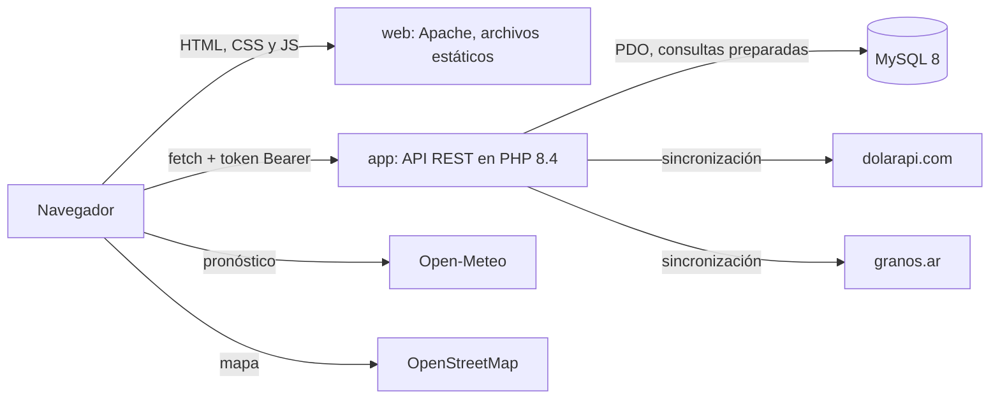

# AgroWatchOut

**¿Lo que sembraste te va a dejar plata?** AgroWatchOut es una aplicación web para productores agropecuarios: el productor carga sus campos, sus lotes y lo que sembró en cada uno con sus costos, y la app calcula el **margen bruto proyectado**, el **rinde de indiferencia** y un **semáforo de rentabilidad** con el precio del grano y el dólar del día.

|                    |                                                                                                |
| ------------------ | ---------------------------------------------------------------------------------------------- |
| **App (frontend)** | https://agrowatchout.up.railway.app                                                            |
| **API**            | https://api-rest-agro.up.railway.app/api                                                       |
| **Materia**        | Aplicaciones Móviles y Cloud Computing (UPSO), Trabajo Práctico Integrador N.º 1               |
| **Docentes**       | Eduardo Mónaco y Heber Alonso                                                                  |
| **Grupo**          | 1                                                                                              |
| **Integrantes**    | Jorge Bianchi, Gabriel R. Iglesias, Marcos San Román, Camila Ailén Rodríguez y Facundo Curiman |

## Índice

1. [Presentación](#1-presentación)
2. [Usuario de prueba](#2-usuario-de-prueba)
3. [Qué hace la app](#3-qué-hace-la-app)
4. [Cómo correrla en local](#4-cómo-correrla-en-local)
5. [Arquitectura](#5-arquitectura)
6. [Endpoints de la API](#6-endpoints-de-la-api)
7. [Lógica de negocio](#7-lógica-de-negocio-cómo-calcula-agrowatchout-si-una-siembra-es-rentable)
8. [Validación (JSON Schema)](#8-validación-json-schema)
9. [Autenticación y autorización](#9-autenticación-y-autorización)
10. [Seguridad](#10-seguridad)
11. [Variables de entorno](#11-variables-de-entorno)
12. [Servicios externos](#12-servicios-externos)
13. [Despliegue](#13-despliegue)
14. [Limitaciones conocidas](#14-limitaciones-conocidas)
15. [Para desarrolladores](#15-para-desarrolladores)
16. [Créditos](#16-créditos)

## 1. Presentación

**Tema:** economía agraria. En Argentina, un productor decide qué sembrar meses antes de saber a qué precio va a vender, con costos que se pagan en pesos y en dólares. La pregunta que responde AgroWatchOut es la que se hace al cierre de cada campaña: **¿lo que sembré me es rentable?** La app la responde antes, mientras el cultivo todavía está en el lote, para que el productor vea a tiempo qué lotes están en riesgo.

### Integrantes

| Integrante             | Rol en el grupo                                                                                                                                |
| ---------------------- | ---------------------------------------------------------------------------------------------------------------------------------------------- |
| Gabriel R. Iglesias    | Backend: validación con JSON Schema, siembras, costos y la lógica del margen bruto. Aporta la lógica agroeconómica (es licenciado en Economía) |
| Jorge Bianchi          | Líder técnico: arquitectura de la API y entorno Docker (trabajo previo al TP, ver sección 5), autenticación, CORS y despliegue en Railway      |
| Marcos San Román       | Backend (modelos) y ventanas emergentes del frontend                                                                                           |
| Camila Ailén Rodríguez | Líder del frontend                                                                                                                             |
| Facundo Curiman        | Frontend                                                                                                                                       |

La participación de cada integrante está en el historial de commits del repositorio.

### Tecnologías

| Capa                  | Tecnología                                                                                  |
| --------------------- | ------------------------------------------------------------------------------------------- |
| Frontend              | HTML, CSS y JavaScript sin frameworks; `fetch` contra la API; Leaflet para el mapa de lotes |
| Backend               | PHP 8.4 sin framework, API REST propia con router, controllers, models y services           |
| Base de datos         | MySQL 8                                                                                     |
| Validación            | JSON Schema con `opis/json-schema`                                                          |
| Cálculo de dinero     | `bcmath` sobre columnas `DECIMAL` (nunca `float`)                                           |
| Entorno de desarrollo | Docker Compose (Apache + PHP, MySQL, Adminer)                                               |
| Despliegue            | Railway (PaaS)                                                                              |

## 2. Usuario de prueba

Para probar la app sin registrarse, hay una cuenta con datos cargados de una campaña realista:

|                |                            |
| -------------- | -------------------------- |
| **Email**      | gabiiglesias90@hotmail.com |
| **Contraseña** | RiverPlate26               |

La cuenta es de un productor ficticio, Matías, con dos establecimientos:

- **La Torcasita:** 9 lotes con trigo y sorgo. Tiene un lote en rojo (Lote 9, trigo con rinde bajo), para ver cómo se muestra una siembra que pierde plata.
- **CARP:** 5 lotes con maíz, girasol y soja, todos en verde.

Los números cambian de un día a otro, porque el margen se recalcula con el precio del grano y el dólar del día.

**Recorrido sugerido (5 minutos):**

1. Entrar con la cuenta de prueba: se abre el **Panel**.
2. Cambiar de campo con el selector de arriba a la derecha y comparar los dos semáforos.
3. En "Lotes, del peor al mejor", tocar **Ver detalle** en el Lote 9 de La Torcasita: muestra el margen del lote y cuánto le falta al rinde para empatar.
4. Abrir la pestaña **"¿Qué puedo cambiar?"** y mover el precio: el semáforo y los rindes de indiferencia se recalculan al instante.
5. Para ver los errores controlados, crear un lote o una siembra con datos inválidos (hectáreas en 0, campos vacíos): la app muestra el mensaje junto al campo, sin romper la pantalla.

## 3. Qué hace la app

| Pantalla                          | Para qué sirve                                                                                                                                                                                                                                                                                                                |
| --------------------------------- | ----------------------------------------------------------------------------------------------------------------------------------------------------------------------------------------------------------------------------------------------------------------------------------------------------------------------------- |
| Inicio (`/`)                      | Presenta la app y lleva al registro o al login                                                                                                                                                                                                                                                                                |
| Registro (2 pasos)                | Crea el usuario y su primer establecimiento, con ubicación en el mapa                                                                                                                                                                                                                                                         |
| Login                             | Inicia sesión; la sesión dura 2 horas                                                                                                                                                                                                                                                                                         |
| Panel                             | Pestaña **"¿Cómo voy?"**: hectáreas sembradas, margen bruto total y por hectárea, semáforo del campo, lotes ordenados del peor al mejor, margen por lote, en qué se va la plata, superficie por cultivo, precios y dólar usados, mapa de lotes y pronóstico del clima. Pestaña **"¿Qué puedo cambiar?"**: simulador de precio |
| Mi establecimiento                | Alta y edición de un campo y de sus lotes (hectáreas totales y efectivas, ubicación en el mapa). Se abre desde la barra superior, con el establecimiento elegido en el panel                                                                                                                                                  |
| Nueva siembra (ventana emergente) | Carga un cultivo en uno o varios lotes a la vez: los costos se cargan una vez y se reparten entre los lotes según sus hectáreas                                                                                                                                                                                               |
| Datos de siembra                  | Completa o corrige los datos de una siembra y sus costos                                                                                                                                                                                                                                                                      |
| Semáforo                          | Resumen del establecimiento por campaña                                                                                                                                                                                                                                                                                       |
| Perfil                            | Datos del usuario, de sus establecimientos y lista de campañas (solo lectura: ver sección 9)                                                                                                                                                                                                                                  |

## 4. Cómo correrla en local

El entorno de desarrollo es **Docker**, no XAMPP. La consigna propone XAMPP, y los docentes permitieron usar tecnologías más avanzadas que las dictadas si se aplican al proyecto. Elegimos Docker porque:

- **Todos trabajamos sobre el mismo entorno.** Las versiones de PHP, Apache y MySQL las fija el repositorio, no la máquina de cada uno: el grupo trabaja en Windows, Mac y Linux y nadie arrastra "en la mía anda".
- **Lo de local es lo de producción.** Los mismos archivos que levantan el entorno de desarrollo construyen la imagen que corre en Railway, así que lo probado es lo que se despliega.
- **Se levanta con un comando**, incluida la base con sus tablas y datos de ejemplo, sin instalar ni configurar nada a mano.
- **Separa de verdad el frontend de la API**, cada uno en su contenedor y su puerto (sección 5). Con XAMPP ambos comparten origen y el CORS no se probaría hasta producción.

El entorno y la arquitectura de la API venían armados de un trabajo anterior del líder técnico del grupo (sección 5), así que no costó tiempo del TP.

### Requisitos

- [Docker Desktop](https://www.docker.com/products/docker-desktop/) instalado y abierto.
- Git.

### Pasos

```bash
git clone <url-del-repositorio>
cd agrowatch-api

# Con make (Linux, Mac o Git Bash con make instalado):
make install

# Sin make (por ejemplo, en Windows):
docker compose up -d --build
docker compose exec app composer install
```

Al terminar:

| Servicio                       | URL                                                                 |
| ------------------------------ | ------------------------------------------------------------------- |
| App (frontend)                 | http://localhost:8082                                               |
| API                            | http://localhost:8080/api                                           |
| Adminer (cliente web de MySQL) | http://localhost:8081 (servidor `mysql`, usuario `app`, base `app`) |

Arranca sin configurar nada: todas las variables tienen un valor por defecto de desarrollo en `docker-compose.yml`. Para cambiar alguno —la contraseña de la base, un puerto ocupado—, copiá **`.env.example`** a `.env` y editá ahí; Docker Compose lo lee solo y `.env` está en `.gitignore`. Ninguno de esos valores es el de producción.

### La base de datos

Los scripts SQL están en **`docker/mysql/init/`** (es la carpeta `sql/` que pide la consigna). Docker los corre solos, en orden, la primera vez que se crea la base:

| Script                           | Qué hace                                                                                               |
| -------------------------------- | ------------------------------------------------------------------------------------------------------ |
| `01-schema.sql`                  | Crea todas las tablas y carga el catálogo de cultivos, un usuario demo y un establecimiento de ejemplo |
| `02-cotizaciones-demo.sql`       | Dos precios de soja y dos dólares de ejemplo, para probar el margen antes de la primera sincronización |
| `03-cultivo-sorgo.sql`           | Agrega el sorgo al catálogo                                                                            |
| `04-establecimiento-lat-lng.sql` | Agrega latitud y longitud a los establecimientos                                                       |

Para crear la base **sin Docker** (en cualquier MySQL 8, por ejemplo el de XAMPP), alcanza con correr los cuatro scripts en ese orden desde phpMyAdmin, Adminer o la consola de MySQL.

### Correrla con XAMPP, sin Docker

No es como la usamos, pero funciona. Son dos sitios, porque la API y el frontend son dos aplicaciones distintas (sección 5):

1. **Base de datos.** En phpMyAdmin, crear la base `app` y el usuario `app` con contraseña `secret` (son los valores por defecto de `src/app/Core/Database.php`; con otros, hay que exportarlos como variables de entorno). Importar en orden los cuatro scripts de `docker/mysql/init/`.
2. **Dependencias.** Con Composer instalado: `composer install` dentro de `src/`. Genera `src/vendor/`, que incluye el autoloader y `opis/json-schema`. Sin esa carpeta la API no arranca.
3. **La API.** Copiar `src/` dentro de `htdocs` (por ejemplo `htdocs/agrowatch/`) y apuntar el `DocumentRoot` del VirtualHost a **`src/public/`**, nunca a `src/`: `app/`, `config/` y `vendor/` tienen que quedar fuera del alcance de las URLs. Hace falta `mod_rewrite` y `AllowOverride All`, porque `src/public/.htaccess` es el que manda todo al front controller y el que reinyecta el header `Authorization`.
4. **El frontend.** Un segundo VirtualHost con el `DocumentRoot` en `web/`, en otro puerto (por ejemplo 8082). También necesita `mod_rewrite` y `AllowOverride All` para `web/.htaccess`.
5. **Conectar los dos.** En `web/js/config.js`, poner en `window.API_BASE_URL` la URL de la API, por ejemplo `http://localhost:8080/api`. Si el frontend queda en otro origen que el de desarrollo, hay que exportar también `CORS_ORIGIN` con ese origen (sección 11), o el navegador bloquea las llamadas.

Usuario demo del entorno local: `demo@demo.test` / `secret`, dueño del establecimiento de ejemplo "La Esperanza". Lo crea `01-schema.sql` en la base local y no es el usuario de prueba de producción.

Para tener precios y dólar del día en local, después de iniciar sesión el panel llama solo a `POST /api/sync/cotizaciones` una vez por día.

## 5. Arquitectura



**El frontend y la API son dos servicios separados**, cada uno con su dominio (o su puerto, en local). La única comunicación entre ellos es HTTP contra la API. Así se pueden desplegar por separado, y la app Android del TP 2 va a consumir la misma API que la web.

| Servicio  | En local                             | En producción (Railway)         | Rol                                                                                                                                           |
| --------- | ------------------------------------ | ------------------------------- | --------------------------------------------------------------------------------------------------------------------------------------------- |
| `app`     | `docker/Dockerfile`, puerto 8080     | `docker/railway/app.Dockerfile` | Apache + PHP: solo la API (`/api/*`). Cada entorno trae su `php.ini`: el de desarrollo muestra los errores, el de producción los manda al log |
| `web`     | `docker/web/Dockerfile`, puerto 8082 | `docker/railway/web.Dockerfile` | Apache: sirve `web/` tal cual, sin compilar nada                                                                                              |
| `mysql`   | `mysql:8` con volumen persistente    | MySQL de Railway                | Base de datos                                                                                                                                 |
| `adminer` | Puerto 8081                          | No se despliega                 | Cliente web de MySQL para desarrollo                                                                                                          |

### Capas del backend

```text
Request -> src/public/index.php (router: única tabla de rutas)
        -> Controller (normaliza, valida, controla permisos)
             -> Validator + src/app/Schemas/*.json (forma del body)
             -> Model (SQL con PDO)            -> MySQL
             -> Service CalculoMargen (cuentas con bcmath, sin base ni HTTP)
        -> JSON de respuesta, o ApiException -> { "error": {...} }
```

### De dónde sale esta arquitectura

El TP no arrancó de cero. **El núcleo de la API y el entorno Docker son trabajo previo del líder técnico del grupo**: una base propia para escribir APIs REST en PHP plano, sin framework, diseñada y probada. Eso explica por qué el proyecto empezó con un front controller, un router, el manejo central de errores, la autenticación por token y los cuatro contenedores ya funcionando, y el tiempo del TP se fue en el dominio agropecuario y en el frontend.

| Pieza                                                            | Qué resuelve                                                                                                         | De dónde viene |
| ---------------------------------------------------------------- | -------------------------------------------------------------------------------------------------------------------- | -------------- |
| Front controller único (`src/public/index.php`) y tabla de rutas | Una sola puerta de entrada: todas las URLs pasan por ahí vía `.htaccess`, y las rutas se registran en un solo lugar  | Previo         |
| `Core/Router`                                                    | Rutas por método y patrón, parámetros tipados (`{id:\d+}` llega como `int`), method override y 404 / 405 en JSON     | Previo         |
| `Core/Controller`                                                | Respuestas uniformes: `json()`, `creado()` (201 + `Location`), `sinContenido()` (204)                                | Previo         |
| `Core/Request`                                                   | Lectura del body JSON y del header `Authorization`                                                                   | Previo         |
| `Core/ApiException` + `set_exception_handler`                    | Un único formato de error `{ "error": { ... } }` para toda la API, con su código de estado                           | Previo         |
| `Core/Auth` + tablas `usuarios` y `tokens`                       | Sesión por token opaco con vencimiento, pensada para servir igual a un cliente web y a uno móvil                     | Previo         |
| `Core/Database`                                                  | Conexión PDO única, credenciales por entorno, consultas preparadas reales                                            | Previo         |
| Entorno Docker y `Makefile`                                      | Los cuatro servicios, la base que se crea sola y los comandos de desarrollo                                          | Previo         |
| `web/js/api.js`                                                  | Cliente `fetch` con token, los cinco verbos y los errores de la API traducidos a excepciones de JavaScript           | Previo         |
| `Core/Validator` + `src/app/Schemas/`                            | Validación de los bodies con JSON Schema (sección 8)                                                                 | **De este TP** |
| `Controllers/`, `Models/` y `Services/CalculoMargen`             | Todo el dominio: establecimientos, lotes, campañas, cultivos, siembras, costos, cotizaciones y el cálculo del margen | **De este TP** |
| Separación `app` / `web` en dos servicios y CORS                 | Que el frontend y la API sean desplegables por separado, y que el navegador cruce origen de verdad                   | **De este TP** |
| `web/html/`, `web/css/` y el resto de `web/js/`                  | El frontend completo de AgroWatchOut                                                                                 | **De este TP** |
| `docker/railway/` y los scripts de `docker/mysql/init/`          | El despliegue en la nube y la base de datos                                                                          | **De este TP** |

La base previa no traía ningún dominio: las tablas, los endpoints y las pantallas de AgroWatchOut son todas de este trabajo.

### Estructura del repositorio

```text
.
├── src/
│   ├── app/
│   │   ├── Core/          Router, Controller, Request, ApiException, Auth, Database, Validator
│   │   ├── Controllers/   Auth, Usuario, Establecimiento, Lote, Campania, Cultivo, Siembra, Costo, Sync
│   │   ├── Models/        Usuario, Token, Establecimiento, Lote, Campania, Cultivo, Siembra, Costo, Cotizacion, TipoCambio
│   │   ├── Services/      CalculoMargen (cálculo del margen) y CalculoException
│   │   └── Schemas/       Un JSON Schema por body (ver sección 8)
│   ├── config/app.php     Configuración leída del entorno (debug, CORS, duración de la sesión)
│   └── public/            Raíz de Apache para la API: index.php (rutas) y .htaccess
├── web/                   Frontend
│   ├── html/              Pantallas
│   ├── css/               Un CSS común y uno por pantalla
│   ├── js/                api.js (cliente de la API), global.js, navbar.js, modales.js y uno por pantalla
│   └── .htaccess          "/" lleva a la página de inicio; las URLs no muestran /html/
├── docker/
│   ├── mysql/init/        Scripts SQL de la base
│   ├── railway/           Dockerfiles y config.js de producción
│   └── ...                Dockerfiles, Apache y php.ini de desarrollo
├── docker-compose.yml
├── .env.example           Plantilla de variables para el entorno local (el .env real no se versiona)
└── Makefile
```

## 6. Endpoints de la API

Todo cuelga de `/api`, recibe y devuelve JSON, y las rutas con sesión piden el header `Authorization: Bearer <token>`. Los errores tienen siempre la misma forma:

```json
{ "error": { "status": 422, "mensaje": "Datos invalidos.", "errores": { "campo": "mensaje" } } }
```

`errores` solo viene en los 422. Códigos que se usan en toda la API:

| Código | Significado                                                                           |
| ------ | ------------------------------------------------------------------------------------- |
| 200    | Lectura o modificación correcta                                                       |
| 201    | Alta correcta, con el header `Location` del recurso creado                            |
| 204    | Baja o logout correctos, sin cuerpo                                                   |
| 400    | El body no es JSON válido                                                             |
| 401    | Falta la sesión, el token no existe o venció, o las credenciales son incorrectas      |
| 403    | El usuario no tiene permiso para modificar ese recurso                                |
| 404    | El recurso no existe o es de otro usuario; también una ruta inexistente               |
| 405    | La ruta existe, pero no con ese método                                                |
| 409    | Duplicado: email ya registrado o siembra repetida                                     |
| 422    | Los datos no cumplen las reglas (ver sección 8) o no alcanzan para calcular el margen |
| 502    | No respondió ninguna de las dos APIs de cotizaciones                                  |
| 500    | Solo ante una falla del servidor                                                      |

### Tabla de rutas

| Método   | Ruta                                  | Sesión | Recibe                                                                                                  | Devuelve                                            | Errores posibles        |
| -------- | ------------------------------------- | ------ | ------------------------------------------------------------------------------------------------------- | --------------------------------------------------- | ----------------------- |
| `POST`   | `/api/usuarios`                       | No     | `nombre`, `apellido`, `email`, `password`                                                               | 201: el usuario                                     | 400, 409, 422           |
| `POST`   | `/api/auth/login`                     | No     | `email`, `password`                                                                                     | 200: `token`, `expira`, `usuario`                   | 400, 401, 422           |
| `GET`    | `/api/auth/me`                        | Sí     |                                                                                                         | 200: `{ usuario }`                                  | 401                     |
| `POST`   | `/api/auth/logout`                    | Sí     |                                                                                                         | 204                                                 | 401                     |
| `GET`    | `/api/establecimientos`               | Sí     |                                                                                                         | 200: los establecimientos del usuario, con su `rol` | 401                     |
| `POST`   | `/api/establecimientos`               | Sí     | `nombre`, `localidad`, `provincia`, `lat`?, `lng`?                                                      | 201: el establecimiento                             | 400, 401, 422           |
| `GET`    | `/api/establecimientos/{id}`          | Sí     |                                                                                                         | 200: uno                                            | 401, 404                |
| `PUT`    | `/api/establecimientos/{id}`          | Sí     | Igual que el alta                                                                                       | 200: el establecimiento                             | 400, 401, 403, 404, 422 |
| `DELETE` | `/api/establecimientos/{id}`          | Sí     |                                                                                                         | 204                                                 | 401, 403, 404           |
| `GET`    | `/api/lotes?establecimiento_id=`      | Sí     |                                                                                                         | 200: lotes del establecimiento                      | 401, 422                |
| `POST`   | `/api/lotes`                          | Sí     | `establecimiento_id`, `nombre`, `ha_totales`, `ha_efectivas`, `lat`?, `lng`?                            | 201: el lote                                        | 400, 401, 403, 404, 422 |
| `GET`    | `/api/lotes/{id}`                     | Sí     |                                                                                                         | 200: uno                                            | 401, 404                |
| `PUT`    | `/api/lotes/{id}`                     | Sí     | `nombre`, `ha_totales`, `ha_efectivas`, `lat`?, `lng`?                                                  | 200: el lote                                        | 400, 401, 403, 404, 422 |
| `DELETE` | `/api/lotes/{id}`                     | Sí     |                                                                                                         | 204                                                 | 401, 403, 404           |
| `GET`    | `/api/campanias`                      | Sí     |                                                                                                         | 200: todas las campañas                             | 401                     |
| `GET`    | `/api/campanias/{id}`                 | Sí     |                                                                                                         | 200: una                                            | 401, 404                |
| `GET`    | `/api/cultivos`                       | No     |                                                                                                         | 200: catálogo de cultivos                           |                         |
| `GET`    | `/api/cultivos/{id}`                  | No     |                                                                                                         | 200: uno                                            | 404                     |
| `GET`    | `/api/siembras?campania_id=&lote_id=` | Sí     | Filtros opcionales                                                                                      | 200: siembras del usuario                           | 401, 422                |
| `POST`   | `/api/siembras`                       | Sí     | `campania_id`, `lote_id`, `cultivo_id`, `ha_sembradas`, `fecha_siembra`, `variedad`?, `rinde_esperado`? | 201: la siembra                                     | 400, 401, 409, 422      |
| `GET`    | `/api/siembras/{id}`                  | Sí     |                                                                                                         | 200: una, con nombres de lote, cultivo y campaña    | 401, 404                |
| `PUT`    | `/api/siembras/{id}`                  | Sí     | Igual que el alta                                                                                       | 200: la siembra                                     | 400, 401, 404, 409, 422 |
| `DELETE` | `/api/siembras/{id}`                  | Sí     |                                                                                                         | 204 (borra también sus costos)                      | 401, 404                |
| `GET`    | `/api/siembras/{id}/costos`           | Sí     |                                                                                                         | 200: costos de la siembra                           | 401, 404                |
| `POST`   | `/api/siembras/{id}/costos`           | Sí     | `categoria`, `descripcion`, `cantidad`, `unidad`, `precio_unitario`, `moneda`, `fecha`                  | 201: el costo                                       | 400, 401, 404, 422      |
| `PUT`    | `/api/costos/{id}`                    | Sí     | Igual que el alta                                                                                       | 200: el costo                                       | 400, 401, 404, 422      |
| `DELETE` | `/api/costos/{id}`                    | Sí     |                                                                                                         | 204                                                 | 401, 404                |
| `GET`    | `/api/siembras/{id}/margen`           | Sí     |                                                                                                         | 200: margen calculado (sección 7)                   | 401, 404, 422           |
| `POST`   | `/api/sync/cotizaciones`              | Sí     |                                                                                                         | 200: qué precios y dólares se guardaron             | 401, 502                |

`?` = opcional. **Las campañas son de solo lectura en la API**: `POST`, `PUT` y `DELETE` sobre `/api/campanias` están deshabilitados a propósito y responden 405 con `Allow: GET`. Son datos compartidos por todos los usuarios y no tienen dueño contra el que autorizar, así que cerrarlas, reabrirlas o borrarlas desde la app afectaría a todos (sección 9). Se cargan en la base.

### Contratos JSON

**Login.**

```json
// POST /api/auth/login
{ "email": "demo@demo.test", "password": "secret" }

// 200
{
  "token": "3f9e2c...",
  "expira": "2026-10-15 16:00:00",
  "usuario": { "id": 1, "nombre": "Usuario", "apellido": "Demo", "email": "demo@demo.test", "created_at": "...", "updated_at": "..." }
}

// 401
{ "error": { "status": 401, "mensaje": "Email o contrasena incorrectos." } }
```

**Establecimientos.** `lat` y `lng` son opcionales. `PUT` reemplaza el recurso completo: si no se mandan `lat` y `lng`, quedan en `null`.

```json
// POST /api/establecimientos
{ "nombre": "La Esperanza", "localidad": "Coronel Suarez", "provincia": "Buenos Aires", "lat": -37.4525, "lng": -61.9333 }

// 201 + Location: /api/establecimientos/1
{ "id": 1, "nombre": "La Esperanza", "localidad": "Coronel Suarez", "provincia": "Buenos Aires",
  "lat": "-37.4525000", "lng": "-61.9333000", "rol": "dueno", "created_at": "...", "updated_at": "..." }
```

**Lotes.** `ha_efectivas` son las hectáreas que se pueden sembrar (sin caminos, bajos ni montes). Un lote no cambia de establecimiento: `PUT` no recibe `establecimiento_id`.

```json
// POST /api/lotes
{ "establecimiento_id": 1, "nombre": "Lote 4", "ha_totales": 62.0, "ha_efectivas": 58.3, "lat": -37.4601, "lng": -61.9420 }

// GET /api/lotes?establecimiento_id=1 -> 200
[ { "id": 4, "establecimiento_id": 1, "nombre": "Lote 4", "ha_totales": "62.00", "ha_efectivas": "58.30",
    "lat": "-37.4601000", "lng": "-61.9420000", "created_at": "...", "updated_at": "..." } ]
```

**Campañas.** Solo se listan y se consultan. El campo `cerrada` marca si se le pueden cargar siembras nuevas; se cambia en la base, no por la API:

```json
// GET /api/campanias -> 200
[ { "id": 2, "nombre": "2026/27", "fecha_inicio": "2026-09-01", "fecha_fin": "2027-06-30",
    "cerrada": 0, "created_at": "...", "updated_at": "..." } ]

// PUT o DELETE /api/campanias/2 -> 405
{ "error": { "status": 405, "mensaje": "Metodo no permitido para esta ruta.", "permitidos": ["GET"] } }
```

**Cultivos** (catálogo de solo lectura, cargado por los scripts SQL):

```json
[{ "id": 1, "nombre": "Soja", "unidad": "tn", "simbolo_api": "soja", "retencion_pct": "33.00" }]
```

**Siembras.** El rinde esperado viaja **en kg/ha** (la pantalla lo pide en quintales por hectárea y lo multiplica por 100). `cultivo_nombre`, `lote_nombre` y `campania_nombre` salen de un `JOIN`: se devuelven en los `GET`, pero no se mandan.

```json
// POST /api/siembras
{ "campania_id": 1, "lote_id": 1, "cultivo_id": 1, "ha_sembradas": 78.0, "fecha_siembra": "2026-10-15", "variedad": "DM 53i53", "rinde_esperado": 3200 }

// 409
{ "error": { "status": 409, "mensaje": "Ya existe una siembra con ese cultivo para este lote en esta campana." } }
```

**Costos.** Cada costo lleva su moneda y su fecha, porque el margen convierte los pesos con el dólar de ese día.

```json
// POST /api/siembras/1/costos
{
  "categoria": "fertilizante",
  "descripcion": "Urea",
  "cantidad": 150,
  "unidad": "kg",
  "precio_unitario": 0.64,
  "moneda": "USD",
  "fecha": "2026-10-12"
}

// 201 + Location: /api/costos/2
```

**Margen.** No guarda nada: se calcula en cada pedido (ver sección 7). Respuesta real de una siembra de prueba:

```json
{
  "siembra_id": 5,
  "ha_sembradas": "90.00",
  "moneda_calculo": "USD",
  "cotizacion_vigente": {
    "precio": "371.35",
    "moneda": "USD",
    "fecha": "2026-10-08",
    "mercado": "pizarra_rosario"
  },
  "retencion_aplicada_pct": "0.00",
  "precio_neto_usd": { "por_unidad": "371.35", "unidad": "tn" },
  "tipo_cambio_usado": { "tipo": "oficial", "valor": "1535.0000", "fecha": "2026-10-09" },
  "costo_total_usd": "4871.36",
  "costo_por_ha_usd": "54.13",
  "ingreso_esperado_usd": "106948.80",
  "margen_bruto_usd": "102077.44",
  "margen_pct": "0.9544",
  "rinde_indiferencia_kg_ha": "145.8",
  "semaforo": "verde",
  "costo_total_ars": "7477537.60",
  "costo_por_ha_ars": "83089.55",
  "ingreso_esperado_ars": "164166408.00",
  "margen_bruto_ars": "156688870.40",
  "detalle_costos": [
    {
      "id": 2,
      "categoria": "semilla",
      "moneda": "USD",
      "importe_original": "2250.00",
      "tipo_cambio": null,
      "importe_usd": "2250.00"
    },
    {
      "id": 3,
      "categoria": "labor",
      "moneda": "ARS",
      "importe_original": "4050000.00",
      "tipo_cambio": { "valor": "1545.0000", "fecha": "2026-09-30" },
      "importe_usd": "2621.36"
    }
  ]
}
```

**Sincronización de cotizaciones.** Si falla una de las dos fuentes, la otra igual se guarda y la respuesta sigue siendo 200, con la fuente caída en `fuentes_con_error`. Solo si fallan las dos responde 502.

```json
// POST /api/sync/cotizaciones -> 200
{
  "tipos_cambio_insertados": [{ "tipo": "oficial", "fecha": "2026-10-13", "valor": "1535.0000" }],
  "cotizaciones_insertadas": [
    {
      "cultivo": "soja",
      "fecha": "2026-10-09",
      "precio": "371.35",
      "moneda": "USD",
      "mercado": "pizarra_rosario"
    }
  ],
  "ya_existian": ["blue 2026-10-13"],
  "fuentes_con_error": []
}
```

## 7. Lógica de negocio: cómo calcula AgroWatchOut si una siembra es rentable

Para responder si lo sembrado es rentable, AgroWatchOut calcula el **margen bruto proyectado** de cada siembra (un cultivo, en un lote, en una campaña) y lo resume en un semáforo. Lo hace `GET /api/siembras/{id}/margen`: `SiembraController::margen()` junta los datos y `App\Services\CalculoMargen` hace todas las cuentas. No guarda nada: se recalcula en cada consulta, con el precio y el dólar del día.

### Conceptos

| Concepto              | Qué es                                                                          | Cómo se calcula                                                                                         |
| --------------------- | ------------------------------------------------------------------------------- | ------------------------------------------------------------------------------------------------------- |
| Costos directos       | Lo que se gasta para producir ese cultivo en ese lote                           | Suma de los costos cargados: semilla, fertilizante, herbicida, maquinaria, labor, flete y otros         |
| Precio neto           | Lo que se cobra por cada tonelada                                               | Precio del grano × (1 − retención ÷ 100)                                                                |
| Producción esperada   | Lo que se espera cosechar                                                       | Rinde esperado (kg/ha) ÷ 1.000 × hectáreas, en toneladas                                                |
| Ingreso esperado      | Lo que se cobraría vendiendo esa producción al precio de hoy                    | Producción esperada × precio neto                                                                       |
| Margen bruto          | Lo que queda después de pagar los costos directos                               | Ingreso esperado − costos directos                                                                      |
| Margen sobre ingreso  | Qué parte del ingreso queda como margen                                         | Margen bruto ÷ ingreso esperado                                                                         |
| Rinde de indiferencia | El rinde mínimo para no perder plata: con ese rinde, el ingreso iguala al costo | Costo por hectárea ÷ precio neto × 1.000, en kg/ha                                                      |
| Colchón               | Cuánto puede bajar el rinde antes de perder plata                               | Rinde esperado − rinde de indiferencia                                                                  |
| Semáforo              | Lectura rápida del margen                                                       | **Rojo** si el margen es 0 o negativo; **verde** si llega al 20 % del ingreso; **amarillo** en el medio |

### El cálculo, paso a paso

1. **Precio del grano.** Toma la cotización más reciente del cultivo con fecha igual o anterior a hoy. Con "igual o anterior", un fin de semana o un feriado usan el último día con dato. Es el precio de la pizarra de Rosario, en USD por tonelada. Si no hay ninguna, responde 422.
2. **Precio neto.** Precio × (100 − retención) ÷ 100. Hoy la retención aplicada es 0 (ver "Por qué lo hicimos así").
3. **Costos en dólares.** Cada costo vale `cantidad × precio_unitario`. Si está en pesos, se divide por el dólar oficial de **la fecha del costo** (el último cargado con fecha igual o anterior). Cada línea se redondea a centavos y recién después se suman: así el total coincide con la suma de las líneas que se ven en `detalle_costos`.
4. **Ingreso esperado.** Hectáreas × (rinde en kg/ha ÷ 1.000) × precio neto.
5. **Margen bruto y margen sobre ingreso.** Margen = ingreso − costo total. Margen sobre ingreso = margen ÷ ingreso, truncado a 4 decimales.
6. **Rinde de indiferencia.** (Costo total ÷ hectáreas) ÷ precio neto × 1.000, en kg/ha.
7. **Semáforo.** El rojo se evalúa primero, para no dividir por un ingreso en cero. La comparación se hace con los valores **sin redondear**: el redondeo (importes a 2 decimales, margen sobre ingreso a 4, rinde de indiferencia a 1) se hace recién al devolver el resultado.
8. **Importes en pesos.** Los campos `*_ars` son solo para mostrar: los resultados en dólares multiplicados por el dólar oficial de hoy.

### Ejemplo 1: cómo cambia el semáforo con el rinde

Ejemplo ilustrativo: 100 ha, precio neto de 300 USD/tn y costos por 60.000 USD (600 USD/ha). Solo cambia el rinde esperado.

| Rinde esperado | Producción | Ingreso (USD) | Margen (USD) | Margen sobre ingreso | Semáforo |
| -------------- | ---------- | ------------- | ------------ | -------------------- | -------- |
| 3.000 kg/ha    | 300 tn     | 90.000        | 30.000       | 33,3 %               | Verde    |
| 2.400 kg/ha    | 240 tn     | 72.000        | 12.000       | 16,7 %               | Amarillo |
| 1.500 kg/ha    | 150 tn     | 45.000        | −15.000      | −33,3 %              | Rojo     |

El rinde de indiferencia es **2.000 kg/ha** en los tres casos: 600 ÷ 300 × 1.000. La prueba: 2.000 kg/ha × 100 ha = 200 tn, y 200 tn × 300 USD = 60.000 USD, igual al costo. No depende del rinde esperado: es el piso contra el que se lo compara.

### Ejemplo 2: una siembra real de la cuenta de prueba

Maíz en el Lote A del establecimiento CARP: 152 ha y un rinde esperado de 95 qq/ha (9.500 kg/ha). Pizarra de Rosario: 194,55 USD/tn (09/10/2026). Dólar oficial: $ 1.535 (13/10/2026).

| Concepto                         | USD por ha                | De dónde sale                          |
| -------------------------------- | ------------------------- | -------------------------------------- |
| Semilla                          | 215,00                    | 1 bolsa × 215 USD                      |
| Fertilizante (fosfato diamónico) | 85,00                     | 100 kg × 0,85 USD                      |
| Fertilizante (urea)              | 140,80                    | 220 kg × 0,64 USD                      |
| Herbicida                        | 75,00                     |                                        |
| Maquinaria                       | 30,00                     |                                        |
| Labor                            | 139,54                    | $ 214.200 ÷ 1.535 (cargada en pesos)   |
| Flete                            | 190,00                    | 9,5 tn × 20 USD                        |
| Otro                             | 85,00                     |                                        |
| **Costo total**                  | **960,34**                |                                        |
| **Ingreso esperado**             | **1.848,23**              | 9,5 tn × 194,55 USD                    |
| **Margen bruto**                 | **887,88**                | 1.848,23 − 960,34 = 48,0 % del ingreso |
| **Rinde de indiferencia**        | **4.936 kg/ha** (49,4 qq) | 960,34 ÷ 194,55 × 1.000                |
| **Colchón**                      | **4.564 kg/ha**           | 9.500 − 4.936                          |

Semáforo **verde**: el margen (887,88 USD/ha) supera el 20 % del ingreso (369,65 USD/ha). Para el lote entero (152 ha), el margen proyectado es de unos 134.958 USD. La lectura para el productor: con estos costos y este precio, el maíz empata con 49 qq/ha; si rinde menos, pierde plata.

En la app los valores pueden diferir en centavos, porque los costos se cargan como totales del grupo de lotes y cada línea se redondea por separado.

### Qué entra y qué no entra

Es un **margen bruto antes de arrendamiento**: el ingreso esperado menos los costos directos que cargó el usuario.

| Entra                                                                                    | No entra                                                                                                       |
| ---------------------------------------------------------------------------------------- | -------------------------------------------------------------------------------------------------------------- |
| Los costos cargados en semilla, fertilizante, herbicida, maquinaria, labor, flete y otro | Arrendamiento (no tiene categoría propia; si se carga, va en "otro")                                           |
| El ingreso: rinde esperado × precio vigente del grano                                    | Gastos de comercialización por tonelada (comisiones, secada), estructura, impuestos                            |
|                                                                                          | Riesgo climático o de precio a cosecha: el rinde esperado es un dato que carga el productor, no una proyección |

**Convenciones de carga:**

- **Semilla propia:** se carga a su valor de mercado a la fecha. Con precio 0, el costo queda subestimado y el margen sale inflado: esa semilla tiene un costo de oportunidad, lo que se habría cobrado vendiéndola como grano. La API acepta precio 0 porque hay casos legítimos (una bonificación del proveedor), y un schema no puede distinguirlos.
- **Rinde esperado 0** es válido: da margen negativo y semáforo rojo. Una siembra **sin** rinde esperado no se puede calcular (422).
- **Sin costos cargados** el margen no se calcula (422), para no mostrar un verde engañoso.

### Lo que muestra el panel

El panel (`web/js/dashboard.js`) junta las siembras de un establecimiento en la campaña actual:

- **Margen total:** suma de los márgenes de cada siembra.
- **Margen por hectárea:** suma de márgenes ÷ suma de hectáreas sembradas. Es un promedio ponderado: un lote de 500 ha pesa más que uno de 10.
- **Margen sobre ingreso y semáforo del campo:** suma de márgenes ÷ suma de ingresos, con los mismos umbrales que una siembra.
- **Rinde de indiferencia y colchón:** por lote, nunca sumados, porque no tiene sentido sumar kilos de soja con kilos de maíz.
- **"¿En qué se va la plata?":** los costos de todas las siembras por categoría, en USD/ha.
- **Precios y dólar usados**, con la fecha de cada uno. Un precio con más de 2 días se marca en rojo.
- **Simulador "¿Qué puedo cambiar?":** mueve el precio entre −40 % y +20 % y recalcula en el navegador el ingreso, el margen, el rinde de indiferencia y el semáforo. Los costos no cambian con el precio. Es una estimación rápida: el valor oficial es el que devuelve la API.

### Errores de negocio (422)

| Mensaje                                                  | Cuándo pasa                                                     |
| -------------------------------------------------------- | --------------------------------------------------------------- |
| `No hay cotizacion cargada para este cultivo.`           | No hay precio del cultivo con fecha igual o anterior a hoy      |
| `No hay tipo de cambio oficial cargado para esta fecha.` | Falta el dólar de hoy, o el de la fecha de algún costo en pesos |
| `No hay costos cargados.`                                | La siembra todavía no tiene costos                              |
| `La siembra no tiene rinde esperado.`                    | Falta el rinde esperado                                         |
| `Las hectareas tienen que ser mayores que 0.`            | Hectáreas inválidas                                             |

Orden en que se informan: siembra inexistente (404), sin cotización, sin dólar de hoy, costo en pesos sin dólar para su fecha y, al final, lo que valida el cálculo (hectáreas, rinde, unidad, precio, costos). En el panel, una siembra con alguno de estos errores aparece en gris ("Sin datos"), muestra el motivo y no afecta al resto de los lotes.

### Cómo se reparte el trabajo en el código

| Capa                                                                                              | Qué hace                                                                         | Qué no hace          |
| ------------------------------------------------------------------------------------------------- | -------------------------------------------------------------------------------- | -------------------- |
| Models (`Cotizacion::vigente`, `TipoCambio::oficialHasta`, `Costo::porSiembra`, `Cultivo::porId`) | Consultas SQL                                                                    | Cuentas              |
| Service `CalculoMargen` (`calcular`, `convertirCosto`, `aUsd`, `aPesos`)                          | Todas las cuentas, con bcmath y números como texto decimal                       | Base de datos y HTTP |
| Controller `SiembraController::margen()`                                                          | Buscar los datos, llamar al Service, convertir sus fallos en 422 y armar el JSON | Cuentas              |

### Por qué lo hicimos así

**Todo en dólares.** Pesos de fechas distintas no se pueden sumar: con inflación, valen distinto. Los granos y los insumos principales se cotizan en dólares, así que cada costo en pesos se convierte con el dólar **de su fecha** y no con el de hoy: un gasto ya hecho no cambia de valor porque se movió el dólar.

**Dólar oficial de dolarapi.com.** Es una referencia pública, gratuita y sin clave. Usamos el valor de venta, que es el que guarda la sincronización. Sabemos que muchas operaciones del agro usan el dólar mayorista: está declarado en "Limitaciones conocidas".

**Pizarra de Rosario, sin descontar retenciones.** La pizarra es el precio del grano disponible en el mercado local, lo que recibe el productor, y ya tiene descontados los derechos de exportación. Restarlos otra vez sería contarlos dos veces. Por eso `retencion_aplicada_pct` vale 0, y la columna `cultivos.retencion_pct` queda para cuando se use un precio FOB (Fase 2). Descartamos decidir la retención según el texto del mercado: es un campo libre, y un "Pizarra" mal escrito habría aplicado un 33 % sin avisar (en el ejemplo 1, el margen pasaba de +12.000 a −11.760 USD).

**bcmath y DECIMAL, nunca float.** Con float, un margen de exactamente 20 % puede quedar en 19,9999… y pintar amarillo en vez de verde: pasó en más de 200 combinaciones de prueba. Los importes llegan de MySQL como texto decimal (`DECIMAL`) y se operan con bcmath con 10 decimales. Se redondea "de 5 para arriba" recién al devolver el resultado.

**Umbral del 20 % para el verde.** Es una decisión del grupo, no un estándar del sector. El margen bruto todavía tiene que pagar el arrendamiento, los gastos de estructura y los impuestos, que la app no incluye. Con menos del 20 % del ingreso, el resultado final queda expuesto a cualquier baja de precio o de rinde. El umbral está definido en `CalculoMargen::UMBRAL_VERDE`, y hay una copia en el front para el simulador.

**Rinde de indiferencia como dato central.** Para un productor, "necesitás 49 qq para empatar" se entiende mejor que un porcentaje, y se compara directo con lo que espera cosechar.

**El margen no se guarda.** Depende del precio y del dólar del día: guardarlo dejaría resultados viejos. Por eso se recalcula en cada consulta.

**Las cuentas viven en un Service puro.** `CalculoMargen` no toca la base ni HTTP: recibe números y devuelve números. Así se puede probar con casos fijos, y el controller no tiene operaciones con plata (en PHP, `"78.00" * "60000.00"` da un float).

## 8. Validación (JSON Schema)

Cada `POST` y `PUT` con body se valida **en el servidor** contra un JSON Schema antes de tocar la base. Usamos la librería `opis/json-schema` a través de un wrapper propio: `App\Core\Validator::validar(string $nombreSchema, array $datos)`. Los schemas son archivos `.json` en `src/app/Schemas/`.

### Dónde vive cada regla

Cada regla vive en una sola capa: la que mejor puede decidirla.

| Capa       | Qué decide                                                                            | Ejemplo                                                    |
| ---------- | ------------------------------------------------------------------------------------- | ---------------------------------------------------------- |
| Schema     | La forma del dato: obligatorios, tipo, largo, rango, formato y listas cerradas        | `ha_totales` tiene que ser mayor que 0                     |
| Controller | Limpiar antes de validar, y las reglas que dependen de otros datos                    | Siembra inexistente o ajena: 404; fecha que no existe: 422 |
| MySQL      | Los límites físicos y las relaciones: `VARCHAR`, `DECIMAL`, claves foráneas, `UNIQUE` | Misma campaña, lote y cultivo ya cargados: 409             |

### El recorrido de un dato

```text
Request (JSON)
  -> Request::json()            400 si el body no es JSON válido o no es un objeto
  -> Controller: normaliza      trim() de los textos; variedad vacía -> null
  -> Validator::validar()       forma: obligatorios, tipos, largos, rangos, formatos, enums -> 422
  -> Controller: lo que un schema no puede controlar
       fecha que existe en el calendario (checkdate)   -> 422
       pertenencia (el recurso es del usuario)         -> 404 o 422
       duplicados (UNIQUE) y referencias (FK)          -> 409 o 422
       reglas de negocio del margen                    -> 422
  -> Model: consultas preparadas con PDO
```

### Schemas

| Schema                  | Endpoint                                       | Qué exige                                                                                                             |
| ----------------------- | ---------------------------------------------- | --------------------------------------------------------------------------------------------------------------------- |
| `auth.login.json`       | `POST /api/auth/login`                         | `email` y `password`: texto no vacío                                                                                  |
| `usuarios.json`         | `POST /api/usuarios`                           | `nombre` y `apellido` (1 a 60 caracteres); `email` con formato de email (hasta 120); `password` de 6 a 72 caracteres  |
| `establecimientos.json` | `POST` y `PUT /api/establecimientos`           | `nombre` y `localidad` (1 a 100); `provincia` (1 a 60); `lat` entre −90 y 90 y `lng` entre −180 y 180, opcionales     |
| `lotes.store.json`      | `POST /api/lotes`                              | `establecimiento_id` entero; `nombre` (1 a 60); `ha_totales` y `ha_efectivas` mayores que 0; `lat` y `lng` opcionales |
| `lotes.update.json`     | `PUT /api/lotes/{id}`                          | Lo mismo, sin `establecimiento_id`: un lote no cambia de establecimiento                                              |
| `campanias.json`        | `POST /api/campanias` (ruta deshabilitada)     | `nombre` (1 a 30); `fecha_inicio` y `fecha_fin` con formato AAAA-MM-DD                                                |
| `campanias.update.json` | `PUT /api/campanias/{id}` (ruta deshabilitada) | Lo anterior, más `cerrada` booleano                                                                                   |

Los dos schemas de campañas quedan sin endpoint que los use: se conservan junto a sus métodos del controller porque documentan el contrato con el que se cargan las campañas, y porque son los que valdrían si en la Fase 2 las campañas pasan a tener dueño.
| `siembras.json` | `POST` y `PUT /api/siembras` | `campania_id`, `lote_id` y `cultivo_id` enteros; `ha_sembradas` mayor que 0; `fecha_siembra` AAAA-MM-DD; `variedad` (hasta 60) y `rinde_esperado` (0 o más, en kg/ha), opcionales |
| `costos.json` | `POST /api/siembras/{id}/costos` y `PUT /api/costos/{id}` | `categoria` de la lista (semilla, fertilizante, herbicida, maquinaria, labor, flete, otro); `descripcion` (1 a 120); `cantidad` mayor que 0; `unidad` (1 a 10); `precio_unitario` 0 o más; `moneda` ARS o USD; `fecha` AAAA-MM-DD |

Los ids aceptan un entero o un texto con solo dígitos (`anyOf`), así que `5` y `"5"` son válidos. Los máximos de los números son los de sus columnas `DECIMAL`: un valor gigante vuelve como 422 en vez de llegar a MySQL y terminar en un 500.

### Qué valida cada endpoint, además del schema

| Endpoint                                                  | Controles extra en el controller o en la base                                                                             | Errores posibles         |
| --------------------------------------------------------- | ------------------------------------------------------------------------------------------------------------------------- | ------------------------ |
| `POST /api/auth/login`                                    | Email y contraseña contra la base                                                                                         | 400, 401, 422            |
| `POST /api/usuarios`                                      | Email único (`UNIQUE`)                                                                                                    | 400, 409, 422            |
| `POST /api/establecimientos`                              | Quien lo crea queda vinculado como dueño                                                                                  | 400, 401, 422            |
| `PUT` y `DELETE /api/establecimientos/{id}`               | Que el usuario esté vinculado y sea dueño                                                                                 | 401, 403, 404, 422       |
| `GET /api/lotes`                                          | `establecimiento_id` obligatorio en la URL                                                                                | 401, 422                 |
| `POST`, `PUT` y `DELETE /api/lotes`                       | El establecimiento o el lote es del usuario, y el usuario es dueño                                                        | 401, 403, 404, 422       |
| `GET /api/siembras`                                       | `campania_id` y `lote_id`, si vienen, tienen que ser enteros                                                              | 401, 422                 |
| `POST` y `PUT /api/siembras`                              | Fecha real (`checkdate`); lote del usuario; campaña y cultivo existentes (FK); combinación campaña + lote + cultivo única | 401, 404 (PUT), 409, 422 |
| `POST /api/siembras/{id}/costos` y `PUT /api/costos/{id}` | La siembra o el costo es del usuario; fecha real (`checkdate`)                                                            | 401, 404, 422            |
| `GET /api/siembras/{id}/margen`                           | Reglas de negocio (sección 7)                                                                                             | 401, 404, 422            |
| `POST /api/sync/cotizaciones`                             | Sesión iniciada                                                                                                           | 401, 502                 |

### Mensajes de error

`Validator` traduce cada error de la librería al formato del contrato, `{ "campo": "mensaje" }`:

| Regla que falla                                           | Mensaje                                                                                       |
| --------------------------------------------------------- | --------------------------------------------------------------------------------------------- |
| Falta un campo obligatorio (`required`)                   | `Requerido.`                                                                                  |
| Texto vacío (`minLength`)                                 | `Requerido.`                                                                                  |
| Texto demasiado largo (`maxLength`)                       | `Maximo N caracteres.`                                                                        |
| Tipo equivocado (`type`)                                  | `Tiene que ser texto.`, `Tiene que ser un numero entero.` o `Tiene que ser numerico.`         |
| Fuera de rango (`minimum`, `exclusiveMinimum`, `maximum`) | `Tiene que ser como minimo N.`, `Tiene que ser mayor que N.` o `Tiene que ser como maximo N.` |
| Formato (`pattern`)                                       | `Formato invalido.`                                                                           |
| Cualquier otra regla (por ejemplo, `enum`)                | `Dato invalido.`                                                                              |

Ejemplo: `POST /api/siembras/5/costos` con `{ "categoria": "semillas", "cantidad": 0, "moneda": "EUR" }` responde:

```json
{
  "error": {
    "status": 422,
    "mensaje": "Datos invalidos.",
    "errores": {
      "descripcion": "Requerido.",
      "unidad": "Requerido.",
      "precio_unitario": "Requerido.",
      "fecha": "Requerido.",
      "categoria": "Dato invalido.",
      "cantidad": "Tiene que ser mayor que 0.",
      "moneda": "Dato invalido."
    }
  }
}
```

El front (`mostrarError()` en `web/js/global.js`) pinta en rojo el campo que corresponde a cada clave de `errores` y muestra el mensaje.

### Por qué lo hicimos así

**JSON Schema en vez de `if` campo por campo.** El schema es la misma descripción que el contrato: agregar un campo es editar un `.json`, no tocar el controller, y todos los endpoints responden los errores con el mismo formato y los mismos mensajes.

**Validar en el servidor aunque el front ya valide.** El front se puede saltear desde la consola del navegador, con Postman o desde la app Android del TP 2. La validación del front es para la comodidad del usuario; la del servidor es la que protege los datos.

**Un schema para alta y otro para modificación cuando las reglas cambian.** En lotes, `establecimiento_id` va solo en el alta; en campañas, `cerrada` va solo en la modificación. Cuando el alta y la modificación piden lo mismo (siembras, costos), hay un solo schema.

**Normalizar antes de validar.** Así el schema valida el dato tal como se va a guardar: un nombre de puros espacios queda vacío y da `Requerido.`.

**Algunas reglas quedan fuera del schema a propósito.** Un schema mira un solo JSON: no sabe si `2026-02-30` existe en el calendario (pasa el formato AAAA-MM-DD), si un lote es del usuario ni si ya hay una siembra igual. Eso lo controlan el controller y la base.

**Sin `additionalProperties`.** Un campo de más se ignora. Como los campos importantes son obligatorios, un nombre mal escrito (por ejemplo, `precio` en vez de `precio_unitario`) igual falla con `Requerido.` y no pasa en silencio.

**Sin `multipleOf: 0.01` para los centavos.** JSON y PHP representan los números como punto flotante binario, y esa regla puede rechazar valores válidos como `0.07`. MySQL redondea a 2 decimales al guardar.

**400 y 422 son errores distintos.** 400 significa que el body no se pudo leer (no es JSON). 422 significa que se leyó, pero los datos no cumplen las reglas.

### Para agregar o cambiar un campo

1. Editar `src/app/Schemas/<recurso>.json`.
2. Si el campo es texto, agregar su `trim()` en el controller, antes de `Validator::validar()`.
3. Actualizar el contrato del endpoint en este README.

## 9. Autenticación y autorización

### Autenticación: quién sos

| Paso                    | Endpoint                               | Qué pasa                                                                                                                                                                                                                                                                 |
| ----------------------- | -------------------------------------- | ------------------------------------------------------------------------------------------------------------------------------------------------------------------------------------------------------------------------------------------------------------------------ |
| Registro                | `POST /api/usuarios`                   | Valida con `usuarios.json`, guarda la contraseña con `password_hash()` (bcrypt) y responde 201 con el usuario. 409 si el email ya existe. No devuelve token: el front hace login después.                                                                                |
| Login                   | `POST /api/auth/login`                 | `Auth::login()` compara la contraseña con `password_verify()`. Si coincide, crea un token aleatorio de 64 caracteres hexadecimales (`random_bytes(32)`), lo guarda en la tabla `tokens` con su vencimiento y responde `{ token, expira, usuario }`. Si no coincide, 401. |
| Cada request con sesión | Header `Authorization: Bearer <token>` | `Auth::usuarioActual()` busca el token sin vencer (`expira_en > NOW()`) y devuelve el usuario, sin `password_hash`. 401 si el token falta, no existe o venció.                                                                                                           |
| Quién soy               | `GET /api/auth/me`                     | `{ "usuario": { ... } }`                                                                                                                                                                                                                                                 |
| Logout                  | `POST /api/auth/logout`                | Borra la fila del token y responde 204.                                                                                                                                                                                                                                  |

```json
// POST /api/usuarios
{ "nombre": "Matias", "apellido": "Perez", "email": "matias@ejemplo.com", "password": "secreto123" }

// 201
{ "id": 7, "nombre": "Matias", "apellido": "Perez", "email": "matias@ejemplo.com", "created_at": "...", "updated_at": "..." }

// 409
{ "error": { "status": 409, "mensaje": "Ya existe una cuenta con ese email." } }
```

El token vence **2 horas después del login** (`TOKEN_TTL_HORAS`), aunque haya actividad. En el front, `web/js/api.js` guarda el token en `localStorage` y lo manda en cada request. Cada pantalla con sesión llama a `usuarioLogueado()` (`web/js/global.js`), que consulta `GET /api/auth/me`; si la respuesta es 401, cierra la sesión y lleva al login.

### Autorización: qué podés ver y modificar

- Cada usuario ve solo los establecimientos a los que está vinculado en la tabla `usuario_establecimiento`. Quien crea un establecimiento queda vinculado como `dueno`.
- Lotes, siembras y costos se buscan siempre con un `JOIN` hasta `usuario_establecimiento` (por ejemplo, `Siembra::buscarDeUsuario()`). Si el recurso es de otro usuario, la respuesta es **404**, igual que si no existiera.
- Al crear o modificar una siembra, el `lote_id` se valida contra los lotes del usuario. Si es ajeno, la respuesta es `422 { "lote_id": "No existe." }`.
- La tabla admite los roles `dueno` y `asesor`, y la API ya responde 403 si un asesor intenta modificar o borrar. En esta entrega todos los usuarios son dueños: compartir un campo con un asesor queda para la Fase 2.
- Campañas, cotizaciones y tipos de cambio son datos compartidos por todos los usuarios: solo exigen sesión iniciada. El catálogo de cultivos es público y de solo lectura.
- **Las campañas no se modifican desde la app.** Como son compartidas y no tienen dueño, no hay usuario al que se le pueda dar permiso de cerrarlas o borrarlas sin afectar a los demás: la decisión fue dejarlas de solo lectura en las dos puntas, la pantalla de Perfil solo las lista y las rutas `POST`, `PUT` y `DELETE` están deshabilitadas en el router (405). Se administran en la base.

### Por qué lo hicimos así

**Token opaco guardado en una tabla, no JWT.** Es más fácil de explicar y de revocar: cerrar sesión es borrar una fila. Sirve igual para el front web y para la app Android del TP 2.

**404 en vez de 403 para recursos ajenos.** Un 403 confirmaría que ese id existe. Con 404, nadie puede averiguar qué ids tienen otros usuarios probando números.

**El mismo mensaje para email inexistente y para contraseña incorrecta.** El login no revela qué emails están registrados. El registro sí lo revela (ver "Limitaciones conocidas").

**Vencimiento de 2 horas, calculado en UTC.** Es corto para limitar el daño de un token robado. Se calcula en UTC porque MySQL compara contra `NOW()` en UTC: calculado en hora argentina, el token nacía tres horas vencido.

**Contraseñas con `password_hash()`.** Nunca se guardan ni se devuelven en texto: ni siquiera `GET /api/auth/me` devuelve el hash.

## 10. Seguridad

| Medida                    | Cómo está implementada                                                                                                                                                                                                                                                                                                                                                                                                                                            |
| ------------------------- | ----------------------------------------------------------------------------------------------------------------------------------------------------------------------------------------------------------------------------------------------------------------------------------------------------------------------------------------------------------------------------------------------------------------------------------------------------------------- |
| Consultas preparadas      | Todas las consultas usan `PDO::prepare()` con parámetros; los filtros opcionales también se arman con parámetros, nunca concatenando datos del usuario. La conexión desactiva la emulación de consultas preparadas (`PDO::ATTR_EMULATE_PREPARES = false`)                                                                                                                                                                                                         |
| Validación en el servidor | JSON Schema en cada body, más los controles del controller y de la base (sección 8)                                                                                                                                                                                                                                                                                                                                                                               |
| Contraseñas               | `password_hash()` (bcrypt) y `password_verify()`; el hash nunca sale de la API                                                                                                                                                                                                                                                                                                                                                                                    |
| Sesiones                  | Token aleatorio de 256 bits, guardado en la base, con vencimiento de 2 horas y revocable con logout                                                                                                                                                                                                                                                                                                                                                               |
| Datos de cada usuario     | Toda consulta de establecimientos, lotes, siembras y costos filtra por el usuario de la sesión; un recurso ajeno responde 404                                                                                                                                                                                                                                                                                                                                     |
| Errores sin detalles      | Dos capas. `APP_DEBUG=0` hace que un error no controlado responda `500 "Error interno del servidor."` sin archivo ni línea. Además, la imagen de producción usa su propio `php.ini` (`docker/php/php.prod.ini`) con `display_errors = Off`, para que ni siquiera un aviso de PHP se imprima en medio de una respuesta JSON: se siguen registrando todos (`error_reporting = E_ALL`, `log_errors = On`), pero van al log del contenedor, que es lo que lee Railway |
| CORS                      | La API solo acepta llamadas del navegador desde el dominio del frontend (`CORS_ORIGIN`), no desde cualquier origen                                                                                                                                                                                                                                                                                                                                                |
| XSS en el front           | Todo texto que viene de la API se escapa con `escapar()` (`web/js/global.js`) antes de insertarlo en la página                                                                                                                                                                                                                                                                                                                                                    |
| Secretos fuera del código | Las credenciales de la base y la configuración se leen con `getenv()`. El archivo `.env` está en `.gitignore`; en producción las variables se cargan en el panel de Railway. Las APIs externas que usamos no necesitan clave                                                                                                                                                                                                                                      |
| Listado de carpetas       | El `.htaccess` del frontend desactiva el listado de directorios (`Options -Indexes`)                                                                                                                                                                                                                                                                                                                                                                              |

Lo que todavía falta en seguridad está en "Limitaciones conocidas".

## 11. Variables de entorno

Solo el nombre y para qué sirve cada una. Los valores reales de producción están cargados en Railway y nunca en el repositorio.

El proyecto **no lee ningún archivo `.env`**: no usa una librería de dotenv. `App\Core\Database` y `src/config/app.php` leen variables de entorno reales con `getenv()`, que en local inyecta `docker-compose.yml` y en producción el panel de Railway. El `.env` de la raíz —opcional, ignorado por git— lo lee **Docker Compose**, para resolver los `${...}` del `docker-compose.yml` antes de levantar los contenedores. `.env.example` es la plantilla versionada, con los nombres y sin ningún valor real.

| Variable                               | Servicio      | Para qué sirve                                                                    |
| -------------------------------------- | ------------- | --------------------------------------------------------------------------------- |
| `DB_HOST` | app | Servidor de MySQL. En local lo fija `docker-compose.yml` en `mysql` (el nombre del servicio dentro de la red de Docker): solo se configura en producción |
| `DB_PORT` | app | Puerto de MySQL. Igual que el anterior: fijo en local |
| `DB_DATABASE`                          | app, mysql    | Nombre de la base                                                                 |
| `DB_USERNAME`                          | app, mysql    | Usuario de la base                                                                |
| `DB_PASSWORD`                          | app, mysql    | Contraseña de la base                                                             |
| `APP_DEBUG`                            | app           | `1` muestra el detalle de los errores 500 (solo en desarrollo); `0` en producción |
| `CORS_ORIGIN`                          | app           | Único origen (dominio del frontend) que puede llamar a la API desde un navegador  |
| `TOKEN_TTL_HORAS`                      | app           | Duración de la sesión en horas (por defecto, 2)                                   |
| `APP_PORT`, `WEB_PORT`, `ADMINER_PORT` | Solo en local | Puertos de la API, del frontend y de Adminer en `docker-compose.yml`              |

La URL de la API que usa el frontend no es una variable de entorno: está en `web/js/config.js` (local) y en `docker/railway/config.prod.js` (producción). No es un secreto: es una dirección pública.

## 12. Servicios externos

| Servicio                                                                            | Para qué                                                                    | Quién lo llama                                | Datos que salen de la app                                                       | Si falla                                                                                 |
| ----------------------------------------------------------------------------------- | --------------------------------------------------------------------------- | --------------------------------------------- | ------------------------------------------------------------------------------- | ---------------------------------------------------------------------------------------- |
| [dolarapi.com](https://dolarapi.com)                                                | Dólar oficial (y los demás tipos de cambio) del día                         | **Backend**, en `POST /api/sync/cotizaciones` | Ninguno: es un `GET` sin parámetros                                             | Se sigue con el último dólar guardado. Si falla junto con granos.ar, 502                 |
| [granos.ar](https://granosar.lfcaucino.workers.dev)                                 | Precio de pizarra de Rosario (soja, maíz, trigo, girasol y sorgo) en USD/tn | **Backend**, en la misma sincronización       | Ninguno: es un `GET` sin parámetros                                             | Se sigue con el último precio guardado; el panel lo marca en rojo si tiene más de 2 días |
| [Open-Meteo](https://open-meteo.com)                                                | Pronóstico de 3 días en el panel                                            | **Navegador**                                 | Latitud y longitud del campo                                                    | El panel muestra "No se pudo cargar el pronóstico." y el resto sigue funcionando         |
| [OpenStreetMap](https://www.openstreetmap.org) con [Leaflet](https://leafletjs.com) | Mapa de lotes y selección de ubicación                                      | **Navegador**                                 | Las coordenadas de la zona que se está mirando (al pedir las imágenes del mapa) | El mapa no se ve; los datos y los cálculos no dependen de él                             |

Ninguno necesita clave, así que no hay claves que esconder.

### Por qué cada uno se llama desde donde se llama

**Cotizaciones y dólar desde el backend.** Son datos compartidos por todos los usuarios y son la base del cálculo del margen: tienen que quedar guardados en la base, con su fecha, para que el cálculo sea reproducible y para que un costo en pesos pueda usar el dólar de su día. Si los pidiera el navegador, cada usuario vería un precio distinto según cuándo entró, y el margen no se podría verificar. Además, el backend controla los tiempos de espera (5 segundos) y la degradación: si una fuente falla, la otra igual se guarda.

**Clima y mapa desde el navegador.** Son datos de visualización que no entran en ningún cálculo y no hace falta guardarlos. Pedirlos directo desde el navegador evita cargar al servidor, y si fallan, solo se pierde ese recuadro.

**Sincronización una vez por día.** El panel dispara `POST /api/sync/cotizaciones` al abrirse, una vez por día por navegador. La sincronización solo inserta lo que falta (respeta los índices `UNIQUE` de fecha y tipo) y nunca pisa un valor ya guardado: así un precio usado para calcular no cambia después.

**Datos personales.** Lo único que sale de la app hacia terceros son las coordenadas de los campos, hacia Open-Meteo y OpenStreetMap. No se envían nombres, emails ni datos económicos.

## 13. Despliegue

**Proveedor: Railway, un PaaS** (plataforma como servicio). Con un IaaS (infraestructura como servicio, por ejemplo una máquina virtual) habría que instalar y mantener el sistema operativo, Apache, PHP, MySQL y los certificados HTTPS. Con un PaaS, la plataforma se encarga de todo eso: nosotros le damos el código y su Dockerfile, y Railway construye la imagen, la publica con HTTPS y administra la base.

**Por qué Railway:**

- Construye las imágenes **con Docker**, el mismo entorno que usamos en desarrollo: lo que anda en local anda en producción.
- Ofrece MySQL administrado en el mismo proyecto.
- Da HTTPS y dominio público sin configurar nada.
- Atiende a cualquier cliente HTTP. Algunos hostings gratuitos bloquean a los clientes que no son navegadores, y la API la va a consumir la app Android del TP 2.

### Servicios en Railway

| Servicio | Se construye con                                                                                                                     | Dominio                                         |
| -------- | ------------------------------------------------------------------------------------------------------------------------------------ | ----------------------------------------------- |
| API      | `docker/railway/app.Dockerfile` (copia `src/`, instala dependencias con `composer install --no-dev` y usa `docker/php/php.prod.ini`) | https://api-rest-agro.up.railway.app            |
| Frontend | `docker/railway/web.Dockerfile` (copia `web/` y reemplaza `config.js` por `docker/railway/config.prod.js`)                           | https://agrowatchout.up.railway.app             |
| MySQL    | Base administrada de Railway                                                                                                         | Solo accesible desde los servicios del proyecto |

### Qué rama se despliega

Railway sigue la rama **`dev`**. Para esta entrega, el despliegue es la **pre-producción** del proyecto: es el entorno donde el grupo prueba sobre la nube lo que va saliendo, con el mismo build y las mismas variables que tendría producción, y es la URL que se entrega. `main` queda para las versiones estables. La distinción importa de cara al TP 2: la app Android va a consumir esta misma API, así que el entorno tiene que estar en línea y comportarse como producción, aunque el ciclo de cambios sea el de una rama de desarrollo.

Que la rama desplegada sea `dev` no relaja nada de lo que corre ahí: el servicio se construye con `docker/railway/app.Dockerfile`, que usa el `php.ini` de producción (`display_errors = Off`), y las variables del panel son las de producción (`APP_DEBUG=0`, `CORS_ORIGIN` con el dominio del frontend).

### Pasos para volver a desplegar

1. Subir los cambios a `dev`. Railway vuelve a construir cada servicio con su Dockerfile y lo publica.
2. Si cambió `web/js/`, subir el número de versión (`?v=`) del archivo en los HTML que lo cargan, para que los navegadores no usen la copia vieja.
3. Si hay cambios en la base (tablas o columnas nuevas), correr el script SQL nuevo contra el MySQL de Railway. Los scripts de `docker/mysql/init/` solo corren solos en una base local recién creada.
4. Verificar: abrir la app desde un celular con datos móviles, iniciar sesión y abrir el panel.

### Desplegar desde cero

1. Crear un proyecto en Railway con tres servicios: MySQL, la API y el frontend.
2. Conectar la API y el frontend al repositorio, cada uno con su Dockerfile de `docker/railway/`.
3. En el servicio de la API, cargar las variables de la sección 11: `DB_*` con los datos del MySQL de Railway, `APP_DEBUG=0`, `CORS_ORIGIN` con el dominio del frontend y `TOKEN_TTL_HORAS`.
4. Generar un dominio público para cada servicio y poner el de la API en `docker/railway/config.prod.js`.
5. Crear las tablas corriendo los scripts de `docker/mysql/init/` en orden (sin `02-cotizaciones-demo.sql`, que tiene datos de ejemplo).

## 14. Limitaciones conocidas

Lo que no llegamos a hacer, lo que funciona en parte y los límites del modelo económico. Las que más afectan al usuario van primero en cada grupo.

### Del modelo económico (decisiones de alcance)

- **Es margen bruto, no el resultado final.** No incluye arrendamiento, gastos de estructura, impuestos, costo financiero ni amortizaciones. Un semáforo verde no garantiza ganancia neta.
- **Precio de hoy, no precio a cosecha.** El ingreso se proyecta con la pizarra del día. Para una campaña en curso, lo correcto sería el precio futuro del mes de cosecha (Matba Rofex), que queda para la Fase 2. El simulador de precio sirve para ver ese riesgo.
- **No descuenta gastos de comercialización.** El ingreso usa la pizarra sin restar la comisión del acopiador, la secada ni otros gastos de venta. Solo se descuenta lo que el usuario cargue como costo (flete u "otro").
- **Un único rinde esperado.** El clima (Open-Meteo) se muestra en el panel, pero no ajusta el rinde ni el semáforo.
- **Dólar oficial minorista.** Los costos en pesos se convierten con el dólar oficial de venta de dolarapi.com. Muchas operaciones del agro se hacen con el dólar mayorista, así que puede haber unos puntos de diferencia.
- **Retenciones.** No se aplican, porque la pizarra ya es neta. La columna `cultivos.retencion_pct` es un dato de referencia que hoy no se usa, no tiene fecha y no está actualizado.

### Datos externos

- **No hay dólar histórico.** La sincronización guarda solo el dólar del día en que corre. Un costo en pesos con fecha anterior al primer dólar guardado no tiene cotización, y el margen responde 422 (`No hay tipo de cambio oficial cargado para esta fecha.`). Hoy se evita cargando esos costos en USD, o cargando el dólar histórico a mano en la base.
- **Cotizaciones que no se publican.** Si granos.ar no publica el precio de un cultivo (devuelve `null`), no se guarda nada y se sigue usando el último precio disponible. El panel lo avisa en rojo ("Hace N días").
- **La sincronización no tiene una tarea programada.** La dispara el panel al abrirse, una vez por día y por navegador. Si nadie entra, los precios no se actualizan.
- **No hay endpoint de lectura de cotizaciones.** No existe un `GET` de cotizaciones ni de tipos de cambio: el panel los toma de la respuesta del margen.

### Funcionalidad incompleta o parcial

- **Editar costos.** La pantalla de edición existe (`datos_de_siembra.html?siembra=ID`), pero desde el panel solo se llega a ella cuando una siembra no tiene margen ("Completar datos de siembra"). Para corregir un costo mal cargado en una siembra con margen, hoy hay que borrarla y cargarla de nuevo.
- **Dos cultivos en el mismo lote.** La API permite cargar un segundo cultivo distinto en un lote que ya tiene siembra en la campaña, pero el panel muestra una sola siembra por lote (la más nueva): la otra no suma en los totales. El doble cultivo (por ejemplo, trigo/soja de segunda) queda para la Fase 2.
- **Hectáreas sin control en el backend.** Que las hectáreas sembradas no superen las efectivas del lote, y que las efectivas no superen las totales, se controla solo en los formularios. La API acepta cualquier valor mayor que 0.
- **La edición de una siembra permite cambiar la campaña, el lote y el cultivo**, aunque los costos ya están repartidos según ese lote y son de ese cultivo.
- **Siembras cargadas en varios lotes a la vez.** Los costos se reparten por hectárea y se guardan en cada lote. Un error de tipeo se corrige lote por lote, y si después se cambian las hectáreas, los costos no se vuelven a repartir.
- **No hay ABM de campañas.** Son compartidas por todos los usuarios y no tienen dueño, así que ningún usuario las puede crear, cerrar ni borrar desde la app: se cargan y se cierran en la base (sección 9). Una campaña nueva, o cerrar la vigente al terminar el ciclo, hoy es una tarea manual. Darles dueño y permisos queda para la Fase 2.
- **Las fechas de la campaña no siguen el año agrícola.** La campaña cargada ("Sep 2026 - Feb 2027") deja afuera la siembra del trigo y la cosecha de la gruesa. Se corrige cambiando las fechas en la base.
- **Borrados con siembras.** Borrar un lote, o un establecimiento cuyos lotes tienen siembras, devuelve 500 en vez de un 409 con un mensaje claro: la base lo impide, pero la API no traduce ese error. (El caso equivalente en campañas sí está traducido a 409, pero hoy no se puede llegar a él desde la app.)
- **Lotes con el mismo nombre.** Se pueden crear dos lotes con el mismo nombre en un mismo campo.
- **Un solo rol.** La base y la API ya contemplan el rol de asesor, pero la app no permite compartir un campo: queda para la Fase 2.
- **Uso sin conexión.** `web/js/sincronizacion.js` guarda una siembra en el dispositivo si no hay señal, pero el modo sin conexión no forma parte del alcance de esta entrega.

### Validación y mensajes

- **Mensajes poco claros en dos casos.** Una contraseña de menos de 6 caracteres responde `Requerido.` (el mismo mensaje de `minLength` que un texto vacío), y un valor fuera de la lista (`enum`) responde `Dato invalido.` sin decir cuáles son los válidos.
- **Algunos textos se convierten antes de validar.** Nombres y emails pasan por `trim((string) ...)` antes del schema, así que un número se acepta como texto.
- **Fechas.** No se controla que `fecha_inicio` sea anterior a `fecha_fin` en una campaña, ni que la fecha de siembra caiga dentro de la campaña.
- **`POST /api/usuarios` responde `Location: /api/usuarios/{id}`**, pero esa ruta no existe.

### Seguridad y sesión

- **Valores por defecto en el código.** `src/app/Core/Database.php` tiene como respaldo las credenciales del entorno local de Docker (`app` / `secret`), que se usan solo si faltan las variables de entorno. No son las de producción.
- **Token en `localStorage`.** Si la página tuviera una vulnerabilidad XSS, un script podría leerlo. Para reducir ese riesgo, el front escapa todo texto que viene de la API antes de insertarlo en la página.
- **Sin límite de intentos de login.** No hay bloqueo ni demora después de varios intentos fallidos.
- **El registro revela si un email existe**, porque responde 409 "Ya existe una cuenta con ese email.".
- **La sesión dura 2 horas fijas.** Se corta aunque el usuario esté trabajando, porque no hay renovación del token.

### Pantallas

- **"Hectáreas sembradas" se compara contra las hectáreas totales.** El panel muestra, por ejemplo, "700 de 915 ha", y la lista de lotes muestra las totales, aunque lo que se puede sembrar son las efectivas.
- **La caché del navegador se controla a mano.** Los archivos `.js` y `.css` llevan un número de versión (`?v=`) que hay que subir en cada cambio; los que no lo tienen pueden quedar viejos en el navegador hasta borrar la caché.

## 15. Para desarrolladores

### Comandos (Makefile)

| Comando                     | Qué hace                                                                                                    |
| --------------------------- | ----------------------------------------------------------------------------------------------------------- |
| `make install`              | Instala las dependencias de Composer si faltan y levanta los cuatro contenedores. Una sola vez por proyecto |
| `make up` / `make down`     | Levanta / apaga los contenedores. `down` no borra datos                                                     |
| `make restart`              | Reinicia sin reconstruir                                                                                    |
| `make shell`                | Consola dentro del contenedor de la API                                                                     |
| `make db-shell`             | Cliente `mysql` conectado a la base                                                                         |
| `make logs`                 | Muestra los logs en vivo                                                                                    |
| `make db-import FILE=x.sql` | Aplica un `.sql` a la base ya creada, sin borrar datos                                                      |
| `make fresh`                | Borra la base y la vuelve a crear con los scripts de `docker/mysql/init/`. Pide confirmación                |
| `make composer CMD="..."`   | Ejecuta Composer dentro del contenedor                                                                      |

Después de un `git pull` que cambie dependencias, `docker compose up` solo no alcanza: hay que correr `make composer CMD=install` (o `docker compose exec app composer install`).

### Agregar una tabla sin perder datos

Los scripts de `docker/mysql/init/` corren solo la primera vez que se crea la base. Para sumar una tabla o una columna a una base con datos:

1. Crear un script numerado, por ejemplo `docker/mysql/init/05-nombre.sql`, con `CREATE TABLE IF NOT EXISTS` o `ALTER TABLE`.
2. Aplicarlo con `make db-import FILE=docker/mysql/init/05-nombre.sql`.
3. Correr el mismo script en el MySQL de Railway.

### Rutas

Las rutas se registran en un solo lugar, `src/public/index.php`, con `$router->get(...)`, `->post(...)`, `->put(...)`, `->patch(...)` y `->delete(...)`. `{id:\d+}` solo acepta dígitos y llega al controller como `int`. El orden importa: la primera ruta que coincide gana, así que las rutas literales van antes que las que tienen parámetros (por ejemplo, `/api/siembras/{id}/margen` antes que `/api/siembras/{id}`).

### Respuestas y errores en un controller

```php
$this->json($datos);                          // 200
$this->creado($datos, "/api/lotes/{$id}");    // 201 + Location
$this->sinContenido();                        // 204

throw new ApiException(404, 'Lote no encontrado.');
throw ApiException::validacion(['nombre' => 'Requerido.']);   // 422
```

`src/public/index.php` atrapa cualquier excepción y la convierte en `{ "error": { ... } }` con su código.

### El cliente JavaScript (`web/js/api.js`)

`api.js` envuelve `fetch` para no repetir lo mismo en cada pantalla: manda el token en cada request, convierte las respuestas de error en un `Error` de JavaScript con `.status` y `.errores`, y guarda o borra el token al iniciar o cerrar sesión.

```js
API.get(ruta)  API.post(ruta, body)  API.put(ruta, body)  API.patch(ruta, body)  API.del(ruta)
API.login(email, password)   API.logout()   API.haySesion()
```

## 16. Créditos

- Precios de granos: [granos.ar](https://granosar.lfcaucino.workers.dev) (pizarra de la Bolsa de Comercio de Rosario, vía Consiagro). Su licencia de uso libre pide citar la fuente.
- Tipos de cambio: [dolarapi.com](https://dolarapi.com).
- Pronóstico del clima: [Open-Meteo](https://open-meteo.com).
- Mapas: [OpenStreetMap](https://www.openstreetmap.org/copyright) y sus colaboradores, con [Leaflet](https://leafletjs.com).
- El núcleo de la API (`src/app/Core/`), el cliente `web/js/api.js` y el entorno Docker son trabajo previo del líder técnico del grupo, reutilizado en este proyecto (sección 5, "De dónde sale esta arquitectura").
